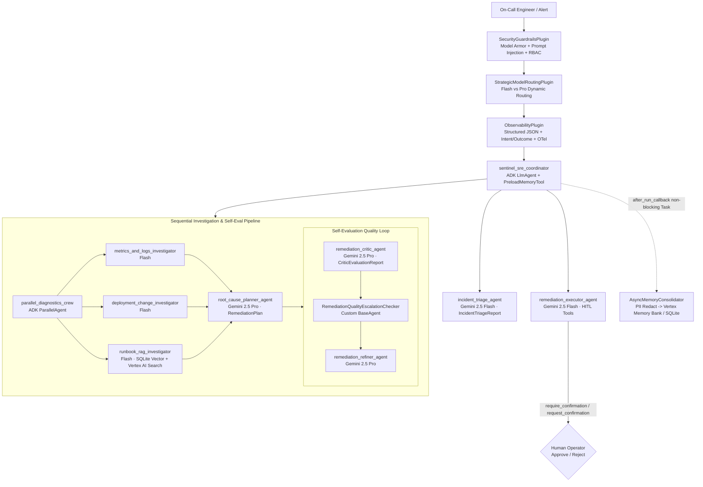

# Sentinel SRE Agent — Enterprise Incident & Remediation Multi-Agent System

[](.github/workflows/ci.yml)
[](https://google.github.io/adk-docs/)
[](pyproject.toml)
[](deployment/terraform/)

**Sentinel** is a production-grade **Enterprise Agents** multi-agent SRE Incident Command & Remediation Copilot built with **Google Agent Development Kit (ADK)**. It triages production incidents, fans out parallel read-only diagnostic specialists, synthesizes evidence-backed remediation plans with Gemini Pro, self-evaluates every plan inside a Critic/Refiner loop, and gates every production mutation behind explicit **Human-in-the-Loop (HITL)** confirmation hooks.

---

## Problem & Solution

**Problem:** During a SEV1 production outage, on-call SREs waste critical minutes correlating metrics, deployment revisions, service dependency blast radius, and internal runbooks across fragmented tools—while risking human error, accidental PII exposure in tickets/logs, or unapproved production rollbacks.

**Solution:** Sentinel orchestrates specialized ADK agents with strict schemas, strategic Flash/Pro model routing, defense-in-depth security guardrails, OpenTelemetry distributed tracing, active PII scrubbing, and Terraform-provisioned Google Cloud infrastructure so teams cut Mean Time To Detect (MTTD) and Mean Time To Resolve (MTTR) safely.

---

## Multi-Agent Architecture



See [docs/ARCHITECTURE.md](docs/ARCHITECTURE.md) for the full design, state-flow contract, and HITL sequence diagram.

---

## AgentOps Code Review Matrix (95 / 95 Coverage)

Every criterion of the **AgentOps Code Review Matrix** is implemented as first-class production code and verified by automated tests:

| Category | Criteria | Implementation Evidence |
|---|---|---|
| **1. Tool & Interface Design** | **Comprehensive Tool Docstrings** | Google-style docstrings documenting purpose, parameter constraints/examples, return schemas, and failure modes on every tool in [`app/tools/diagnostics_tools.py`](app/tools/diagnostics_tools.py) & [`app/tools/remediation_tools.py`](app/tools/remediation_tools.py). |
| | **Descriptive Naming** | Highly specific verb-noun tool names: `fetch_service_error_metrics`, `query_recent_deployment_changes`, `search_incident_runbooks_vector_store`, `inspect_service_dependency_topology`, `rollback_production_deployment`, `scale_cloud_run_replicas`, `create_critical_incident_ticket`. |
| | **Explicit JSON Schemas** | Strict Pydantic v2 input/output models (`extra="forbid"`, regex/range constraints, `export_all_tool_json_schemas()`) in [`app/schemas/models.py`](app/schemas/models.py) + `output_schema=` on triage, planner, critic, and refiner agents. |
| | **Guided Error Handling** | Structured `ToolErrorResponse` with `error_code`, `recovery_instructions`, `valid_examples`, and `suggested_next_tool` in [`app/tools/errors.py`](app/tools/errors.py) + `on_tool_error_callback` recovery in [`app/observability/observability_plugin.py`](app/observability/observability_plugin.py). |
| **2. Context & Memory** | **Robust System Instructions** | Explicit XML-structured Agent Constitutions (persona, SRE domain knowledge, operational principles, safety constraints, HITL policy, error recovery, output contract) in [`app/prompts/constitution.py`](app/prompts/constitution.py). |
| | **History Compaction** | ADK `EventsCompactionConfig` (`compaction_interval`, `overlap_size`, `token_threshold`, `event_retention_size`, Gemini Flash `LlmEventSummarizer`) + `ContextCacheConfig` + deterministic `SlidingWindowCompactor` in [`app/memory/compaction.py`](app/memory/compaction.py). |
| | **Persistent Session State** | `VertexAiSessionService` / `DatabaseSessionService` (Cloud SQL PostgreSQL / SQLite), `VertexAiMemoryBankService` / `PersistentSqliteMemoryService` in [`app/memory/session_factory.py`](app/memory/session_factory.py), plus `PersistentRunbookVectorStore` + `VertexAiSearchTool` in [`app/tools/knowledge_store.py`](app/tools/knowledge_store.py). |
| | **Async Memory Operations** | Non-blocking background `asyncio.create_task` memory consolidation with bounded concurrency, PII scrubbing, and graceful `drain()` in [`app/memory/async_consolidator.py`](app/memory/async_consolidator.py). |
| **3. Orchestration & Logic** | **Multi-Agent Patterns** | ADK Coordinator (`LlmAgent`), `SequentialAgent`, `ParallelAgent`, `LoopAgent`, and custom `BaseAgent` (`RemediationQualityEscalationChecker`) in [`app/agent.py`](app/agent.py). |
| | **Strategic Model Routing** | `ModelRouter` + `StrategicModelRoutingPlugin` routing fast triage/diagnostics/compaction to `gemini-2.5-flash` and root-cause synthesis/self-eval/SEV1 escalations to `gemini-2.5-pro` in [`app/routing/model_router.py`](app/routing/model_router.py). |
| | **Guardrails & Policy Plugins** | `SecurityGuardrailsPlugin` (Google Cloud Model Armor + prompt-injection/jailbreak filter + read-only RBAC tool enforcement + output PII scrubbing) in [`app/security/guardrails_plugin.py`](app/security/guardrails_plugin.py) + autonomous Critic self-evaluation loop in [`app/agent.py`](app/agent.py). |
| | **Human-in-the-Loop Hooks** | Declarative `FunctionTool(..., require_confirmation=...)` (unconditional + conditional predicates) AND programmatic `tool_context.request_confirmation(...)` / `tool_confirmation` pause/approve/reject stops in [`app/tools/remediation_tools.py`](app/tools/remediation_tools.py) with `ResumabilityConfig(is_resumable=True)`. |
| **4. Observability & Tracing** | **Structured JSON Logging** | Cloud Logging–compatible structured JSON via `structlog` (with zero raw `print()` calls enforced by unit test) in [`app/observability/logging.py`](app/observability/logging.py). |
| | **Intent vs. Outcome Capture** | `ObservabilityPlugin` records paired `phase="intent"` (before execution) and `phase="outcome"` (after execution/error) audit logs linked by `action_correlation_id` in [`app/observability/observability_plugin.py`](app/observability/observability_plugin.py). |
| | **Distributed Tracing** | OpenTelemetry `TracerProvider` with `CloudTraceSpanExporter`, `OTLPSpanExporter`, W3C trace/span correlation in logs, nested spans, and `otel_to_cloud=True` in [`app/observability/tracing.py`](app/observability/tracing.py) & [`app/server.py`](app/server.py). |
| | **PII Redaction** | `PiiRedactor` integrating Google Cloud DLP (`DlpServiceClient.deidentify_content`) + deterministic regex/Luhn fallback wired into logging, memory consolidation, ticket storage, and model outputs in [`app/security/pii_redactor.py`](app/security/pii_redactor.py). |
| **5. Infrastructure & CI/CD** | **Automated Evaluation Suites** | Official ADK [`tests/eval/eval_config.json`](tests/eval/eval_config.json) & golden dataset [`tests/eval/evalsets/sre_incident_golden.evalset.json`](tests/eval/evalsets/sre_incident_golden.evalset.json), dual-mode runner [`tests/eval/run_eval.py`](tests/eval/run_eval.py), `pytest` suite, and [`.github/workflows/ci.yml`](.github/workflows/ci.yml). |
| | **Infrastructure as Code** | Modular Terraform IaC in [`deployment/terraform/`](deployment/terraform/) (APIs, IAM, Secret Manager, Cloud SQL, GCS, Vertex AI Search, Vertex AI Agent Engine, Model Armor, Cloud DLP, Cloud Run, BigQuery Analytics) + [`Dockerfile`](Dockerfile), [`Makefile`](Makefile), and `adk` / `agents-cli` / Agent Starter Pack docs in [`docs/DEPLOYMENT.md`](docs/DEPLOYMENT.md). |
| | **Secure Secret Management** | Zero hardcoded credentials (verified by static AST/regex test); Google Cloud Secret Manager versioned loader with fail-closed prod mode in [`app/security/secrets.py`](app/security/secrets.py) + Secret Manager env injection in [`deployment/terraform/secrets.tf`](deployment/terraform/secrets.tf) & [`deployment/terraform/cloud_run.tf`](deployment/terraform/cloud_run.tf). |

---

## Quick Start (Local Development with ADK & Agent CLI)

### 1. Install Dependencies

```bash
git clone https://github.com/orbrokman/sentinel-sre-agent.git
cd sentinel-sre-agent
cp .env.example .env

# Option A: uv (recommended — matches Google Agent Starter Pack / agents-cli)
uv sync --extra dev

# Option B: standard venv + pip
python3 -m venv .venv && source .venv/bin/activate
pip install -e ".[dev]"
```

### 2. Run Locally via ADK CLI or `agents-cli`

```bash
# Interactive ADK Web UI (inspect multi-agent traces, state, & HITL confirmations)
adk web .

# CLI conversational mode
adk run app

# Or using Google Agent CLI (`uv tool install google-agents-cli`)
agents-cli playground

# Production FastAPI server with /healthz, /schemas, and OTel tracing
uvicorn app.server:app --host 0.0.0.0 --port 8080
```

### 3. Run Tests & Automated Golden Evaluations

```bash
# Full unit, integration, and golden dataset regression suite (offline-safe)
pytest

# Deterministic golden dataset evaluation gate (CI mode)
python -m tests.eval.run_eval --mode offline --min-pass-rate 1.0

# Live ADK LLM-as-judge evaluation against Vertex AI / Gemini
adk eval app tests/eval/evalsets/sre_incident_golden.evalset.json \
  --config_file_path tests/eval/eval_config.json
```

---

## Deployment (Terraform IaC + ADK / Agent Starter Pack)

Provision all required Google Cloud resources (Vertex AI Agent Engine, Memory Bank, Vertex AI Search, Secret Manager, Cloud DLP, Model Armor, Cloud SQL, Cloud Run, Cloud Trace, and BigQuery Analytics) with Terraform:

```bash
cd deployment/terraform
cp terraform.tfvars.example terraform.tfvars
# Edit terraform.tfvars with your GCP project_id
terraform init
terraform plan -var-file=terraform.tfvars
terraform apply -var-file=terraform.tfvars
```

Then deploy using either **Vertex AI Agent Engine** or **Cloud Run** via `adk deploy` / `agents-cli`:

```bash
# Deploy to Vertex AI Agent Engine
make deploy-agent-engine GOOGLE_CLOUD_PROJECT=your-gcp-project-id

# Or deploy via ADK CLI to Cloud Run with Cloud Trace enabled
make deploy-cloud-run GOOGLE_CLOUD_PROJECT=your-gcp-project-id
```

Full step-by-step cloud deployment, Secret Manager population, and `agents-cli` / Agent Starter Pack commands are documented in [docs/DEPLOYMENT.md](docs/DEPLOYMENT.md).
