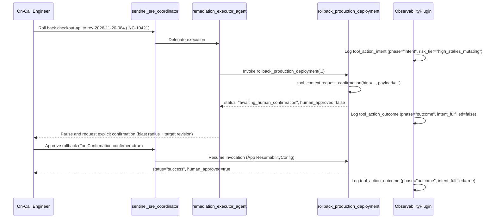

# Sentinel SRE Agent — Architecture Deep Dive

## 1. Multi-Agent Design Patterns

Sentinel deliberately decomposes incident command into composable Google ADK primitives instead of a monolithic prompt:

1. **Coordinator (`sentinel_sre_coordinator` — `LlmAgent`)**:
   - Owns the user conversation, preloads cross-session context via `PreloadMemoryTool()`, enforces the top-level SRE Constitution, and routes work across specialized sub-agents.
   - Starts on `gemini-2.5-flash` for low-latency routing and dynamically escalates to `gemini-2.5-pro` via `StrategicModelRoutingPlugin` for SEV1 outages or high-complexity multi-signal requests.
2. **Fast Intake (`incident_triage_agent` — `LlmAgent`)**:
   - Runs on `gemini-2.5-flash` with `output_schema=IncidentTriageReport` and `output_key="triage_report"`.
   - Normalizes service names and severity (`SEV1`–`SEV4`) cleanly into shared session state.
3. **Deterministic Pipeline (`incident_investigation_pipeline` — `SequentialAgent`)**:
   - **Fan-Out (`parallel_diagnostics_crew` — `ParallelAgent`)**: Runs `metrics_and_logs_investigator`, `deployment_change_investigator`, and `runbook_rag_investigator` concurrently on `gemini-2.5-flash`, writing isolated state keys (`metrics_findings`, `deployment_findings`, `runbook_findings`) to avoid race conditions.
   - **Synthesis (`root_cause_planner_agent` — `LlmAgent`)**: Runs on `gemini-2.5-pro` with `output_schema=RemediationPlan` to correlate all three diagnostic streams into an evidence-cited remediation plan.
   - **Self-Evaluation (`remediation_quality_loop` — `LoopAgent`)**: Pairs `remediation_critic_agent` (Pro, `CriticEvaluationReport`) with deterministic `RemediationQualityEscalationChecker` (`BaseAgent`) and `remediation_refiner_agent` (Pro) for up to 3 refinement iterations until groundedness >= 0.8, safety >= 0.9, completeness >= 0.8, and `policy_violations == []`.
4. **HITL-Protected Execution (`remediation_executor_agent` — `LlmAgent`)**:
   - The **only** agent permitted by `SecurityGuardrailsPlugin` RBAC rules to invoke mutating tools (`rollback_production_deployment`, `scale_cloud_run_replicas`, `create_critical_incident_ticket`).

---

## 2. Human-in-the-Loop (HITL) Pause & Resume Sequence

---

## 3. Context, Memory & Compaction Lifecycle

| Layer | Local / CI Default | Production (Google Cloud) |
|---|---|---|
| **Short-Term Session State** | `DatabaseSessionService` (`sqlite+aiosqlite:///./data/sentinel_sessions.db`) | `VertexAiSessionService` (Vertex AI Agent Engine) or Cloud SQL PostgreSQL |
| **History Compaction** | ADK `EventsCompactionConfig` (`LlmEventSummarizer` on Flash, interval=6, overlap=2, token_threshold=24000, retention=4) + `SlidingWindowCompactor` | Same + Gemini `ContextCacheConfig` (min_tokens=2048, TTL=1800s) |
| **Knowledge / Runbook Retrieval** | `PersistentRunbookVectorStore` (SQLite persisted 128-d L2 embeddings + cosine similarity) | `PersistentRunbookVectorStore` + ADK `VertexAiSearchTool` |
| **Cross-Session Long-Term Memory** | `PersistentSqliteMemoryService` (SQLite vector episodic store) | `VertexAiMemoryBankService` (Vertex AI Agent Engine Memory Bank) |
| **Async Consolidation** | `AsyncMemoryConsolidationPlugin` -> `asyncio.create_task` + `PiiRedactor` before storage | Same non-blocking background worker writing PII-scrubbed episodes |

---

## 4. Plugin Execution Order

Registered on `App(plugins=[...])` in [`app/agent.py`](../app/agent.py):

1. `SecurityGuardrailsPlugin` — blocks prompt injections, Model Armor violations, RBAC violations, and scrubs output PII first.
2. `StrategicModelRoutingPlugin` — assigns/escalates `llm_request.model` (Flash vs Pro) before inference.
3. `ObservabilityPlugin` — starts/ends OpenTelemetry spans, emits structured JSON Intent-vs-Outcome audit logs, and catches unexpected tool exceptions into guided recovery errors.
4. `AsyncMemoryConsolidationPlugin` — dispatches non-blocking background memory writes in `after_run_callback` and drains gracefully in `close()`.
